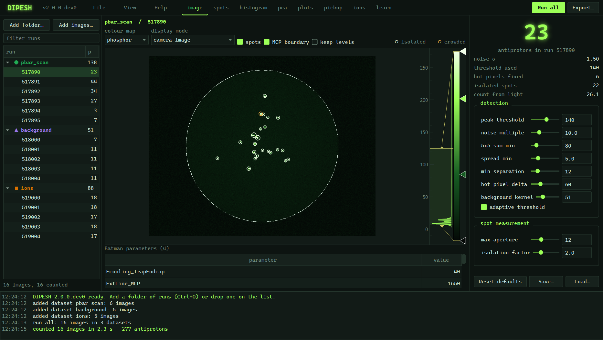
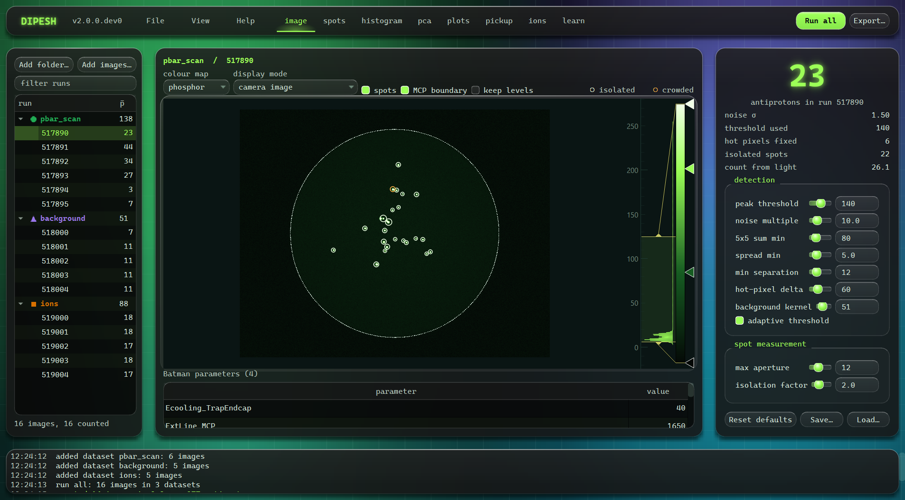

# DIPESH
[](https://doi.org/10.5281/zenodo.23286325)
**Detection and Imaging of Pbar Events, Spots and Hits**

Antiproton counting and data analysis tool, built by Dipesh Bhanushali.

DIPESH counts antiprotons in MCP / phosphor-screen camera images and analyses
them — with the PicoScope pickup signals of the same runs alongside.

Add folders of runs on the left. Pick an analysis on the top bar. Drag the
detection settings on the right and watch the count change live.

| analysis | what it shows |
|---|---|
| **image** | the frame, every counted spot drawn at the aperture its light was summed over, the run parameters underneath |
| **spots** | every spot's measurements as a sortable table; double-click a row to jump to that spot |
| **histogram** | one spot feature across datasets, with the separation score and the cut that best splits two of them |
| **pca** | all brightness and shape features at once, 2σ ellipses per dataset, the loadings that drive PC1 |
| **plots** | any run quantity (count, luminosity, pickup timing or size) against any run parameter, repeats averaged, fitted |
| **pickup** | both scopes' channels on the shared experiment clock, trap RF notched out, pulse time, amplitude, area and width |

**Run all** counts and measures every image in every dataset. **Export**
writes the results — and appends to the master archive if you want.

---

## Install

**Windows, no Python:** download `DIPESH-setup` from the [Releases] page and
run it. No admin rights needed. The first launch shows a SmartScreen warning
because the program is not code-signed: *More info* → *Run anyway*.

**With Python 3.10 or newer** (any OS):

```powershell
cd DIPESH
py -m pip install .
dipesh
```

If `dipesh` is not found, pip put it outside your PATH; this always works:

```powershell
py -m dipesh
```

---

## Working with it

**Add data.** *Add folder…* (Ctrl+O) takes any of:

- a folder of `pbar_run_XXXXXX…` folders — one entry per run, with its
  run parameter file (`Batman.json`) and PicoScope files picked up
  automatically (both are optional)
- a single run folder
- a folder of loose images or videos
- a folder holding any of these at any depth

*Add images…* takes files directly. You can also drop folders onto the list.

Every folder with runs or loose files becomes a **dataset**, named after the
folder, with its own colour and marker shape. (Two folders with the same name
are told apart by their path; loose files next to run folders become a second
dataset, "*folder* (files)".) Add pbar, background and ion runs as separate
datasets and the histogram, PCA and plots compare them. Double-click a
dataset's name to rename it.

**Files that are read.**

| Kind | Extensions | Items |
|---|---|---|
| Still images | `.tif` `.tiff` `.png` `.jpg` `.jpeg` `.bmp` | one per image |
| Multi-page TIFF | `.tif` `.tiff` | one per page: `stack.tif [page 3]` |
| Videos | `.avi` `.mp4` | one per frame: `clip.avi [frame 12]`, frames from 0 |

A video's frames are read one at a time, when they are needed; the whole
video is never loaded. Right-click a dataset with videos and pick *Choose
frames…* to use only some of them (first, last, every how many). In a run
folder the first TIFF is used, else the first other image, else the first
video. Anything else is **not dropped silently**: each file that is skipped
gets a line in the log saying why, and the summary under the list says how
many were skipped.

**Colour and bit depth.**

- Colour images become grey. The alpha channel, if any, is dropped. If the
  three colour channels are equal everywhere (a grey image saved as colour, as
  most camera videos are) one of them is kept unchanged; otherwise
  grey = 0.299 R + 0.587 G + 0.114 B (ITU-R BT.601, the weights OpenCV uses),
  without rounding.
- Integer images (8, 10, 12 or 16 bit) keep the 1.0 rule: the values are
  scaled to 0–255 by the camera's full scale (255, 1023, 4095 or 65535: the
  smallest one at or above the image's highest pixel), never by the image's own
  maximum.
- Floating-point images (for example a median background saved as 32-bit
  float): NaN and infinite pixels become 0. If no pixel is above 1.0, the image
  is taken as a fraction of full scale and multiplied by 255. Otherwise the
  values are kept and the integer rule above applies to them, so a float image
  on the 0–255 scale counts exactly like the same image stored as 8 bit.

**Look.** *View* offers two themes; the choices are remembered.
*Phosphor* (the default) is the 1.0 look: a green-black scope screen.
*Glass* has two intensities (*View > Glass intensity*):

- *Strong* (the default): liquid glass. Large soft colour blobs (phosphor
  green, teal, a little violet) drift slowly behind clear glass panels with a
  strong blur, a lit top edge, a gradient border, rounded corners and a
  shadow; buttons, fields and sliders are small glass pills; menus and
  dialogs are glass too. *View > Animate background* turns the drift off (it
  is also off when Windows asks for fewer animations), and it never redraws
  while you move a slider or the analysis is working.
- *Subtle*: frosted panels over a dark backdrop with a soft glow.

In both, plot and image areas stay opaque, and every text colour keeps a
contrast of at least 4.5:1 (WCAG AA) on the lightest glass it can sit on
(muted text is a lighter grey in Strong for that). On Windows 11 the window
frame also gets the system's Mica backdrop and a dark title bar. Screenshots
of every page in each look are written to `docs/screenshots/v2/` by
`py docs/make_screenshots.py` (only these two are kept in git):




**Move around.** Click a run, or use ↑ ↓ in the list, or PgUp / PgDn from
anywhere. Ctrl+1 … Ctrl+6 switch analysis.

**Tune.** On *image* and *spots*, the settings on the right re-detect the
current frame as you drag — about 0.1 s per frame. White rings are isolated
spots, amber rings crowded ones; each ring is the aperture the spot's light
was summed over. The big number is the count. When the settings change after
a run all, the button turns amber and reads *Run all again*: the counts in
the list are then out of date.

**Save settings** writes them to a `.json`; **Load** reads one back, including
the `params.json` an export writes — so you can always reproduce an old result.

**Export** (Ctrl+E) writes:

```
counts.csv     one row per run: count, luminosity count, integrated light,
               noise, threshold, every run parameter, every pickup number
spots.csv      one row per spot: position, luminosity, size, shape, isolation
params.json    the exact settings used
marked/        one image per run with the counted spots circled (optional)
```

and optionally appends to `master_runs.csv` / `master_spots.csv` in a folder
you choose. Runs already in the archive are skipped unless you ask for them to
be replaced; the runs table grows new columns as new run parameters appear,
and nothing is ever dropped.

---

## What is measured

**Detection** — hot pixels out (a hot pixel that survives passes every later
test), scale by camera bit depth (never by the image's own maximum, so a
threshold means the same signal in every run), two-pass background so a spot
does not raise its own baseline, threshold (fixed, and with *adaptive* also a
multiple of the image noise), shape cuts against single-pixel specks,
non-maximum suppression so one particle is counted once.

**Per spot** — an aperture grown until the light stops increasing; inside it
the luminosity, area, radial σ, and three shape features that do not depend on
brightness: concentration (light within 2 px), eccentricity (0 round, → 1
streak), profile slope (how fast light falls off). A spot is *isolated* when
its nearest neighbour is further than the isolation factor × its aperture —
crowded spots share light, so their luminosity is not one particle's.

**Per image** — integrated light inside the MCP circle, and a count from light
(integrated light ÷ the average single-spot light) that still works when spots
merge.

**Pickup** — files named `Picoscope_ch{A-D}_{tag}_….json`. The tag tells the
two scopes apart; scope B's time axis is shifted by a run parameter in µs
(default `PT_TrapTime`) so both share one experiment clock. If the configured
tags match nothing, *Find in files* reads them from the filenames. The trap RF
(26.92 MHz and harmonics) is removed with a zero-phase notch, which does not
move the pulse in time. A pulse must stand a set number of noise σ above the
baseline to count as found.

---

## Ions

The *ions* page (and `dipesh.ion_analysis` for scripts) counts ions in MCP
release videos: a video, or a folder of frames, per dataset. Every number
below is a setting, saved with the dataset as JSON; *start from* offers the
defaults and named presets.

**Datasets.** *Add videos…* or *Add folder…* (every video and folder of
frames below it). The storage time is read from the name when it is written
with a unit (`storage_time_10min`, `45 mins`, `20s`, `1 min 16 sec`); a
number without a unit is never taken for a time. Edit it, the series, the
frames used (`first-last`) and the frames *left out* (`0-1, 5`) in the table.
Left-out frames stay in every table, marked, and are left out of every total;
ticking *leave this frame out* in the viewer counts again at once, without
reading the video.

**Background.** The per-pixel median of a set of frames, taken off every
frame and clipped at 0: the *darkest* n frames (least light), n frames at
*random* (with a seed), *all* frames, or every frame of a separate background
*video*. Colour frames become grey exactly (BT.601) or rounded to whole counts
(as most video tools do).

**Region.** Single ions are counted on the whole frame, in a rectangle, in a
circle, or in a *ring* around a pile-up disc where ions overlap. Drag the
circles in the viewer.

**Single ions.** A local maximum (`local` px) above a peak threshold, whose
box sum (`box` px, 5 or 7) is above a threshold, at least a minimum distance
from a brighter one; optionally a spread cut against hot pixels. Equally
bright candidates are taken in reading order (row by row).

**Calibration (single-ion signal, SIS).** The light of a single ion, measured
in a box or a round aperture, optionally minus a background per pixel (fixed,
or measured away from ions in the sparsest frames); the ions used are all,
those above the frame's median, or isolated ones; their mean or median; one
SIS per frame or one for the dataset (over frames with enough ions). A frame
without single ions uses no SIS (no estimate), a fixed value, or is skipped.

**Pile-up disc.** N = S / SIS, with S the disc's light above a pixel
threshold, the disc's light minus a baseline (a percentile of the disc over
the frames, or a fixed value), or the disc's light minus the background per
pixel (with a minimum below which there is no blob). Rounded to whole ions or
not. Several methods run side by side, each with its own calibration.

**Totals.** Single ions + disc ions over the frames used: every frame, or only
frames whose count is above a threshold.

**Errors.** Each dataset has an error table, empty until you add components:
Poisson sqrt(N); the spread between counting methods (standard deviation or
half range); a fixed fraction of N; a value typed in; per-frame errors summed
in quadrature. Each is statistical or systematic; they combine in quadrature
or linearly.

**Decay.** N0 exp(-t / tau) fitted to any datasets or series, weighted by
their errors (absolute), with tau, N0, their covariance and the reduced
chi-squared; or tau from two datasets with first-order error propagation.
*Export* writes the per-frame tables, the totals with their errors, every
error component and a JSON of everything.

```python
from dipesh.ion_analysis import IonDataset, analyse, preset
from dipesh.ion_analysis.params import RegionParams, PileupMethod

params = preset("default").with_(
    region=RegionParams("ring", cx=640, cy=512, r=370,
                        inner_cx=640, inner_cy=512, inner_r=65),
    methods=(PileupMethod(name="disc"),))
r = analyse(IonDataset("release", r"C:\DATA\release.avi", exclude=(0,)), params)
print(r.totals["disc"])
```

---

## For scripts

```python
from dipesh import scan, analyse, DetectionParams

items = scan(r"C:\DATA\my_runs")
results = [analyse(it, DetectionParams(abs_thresh=160)) for it in items]
for r in results:
    print(r.item.run_number, r.n, r.info.integrated_lum, r.batman.get("ExtLine_MCP"))
```

`scan()` reads one folder; `items.skipped` lists what it did not use and why.
`scan_tree(folder)` reads every folder below as well and returns
`([(dataset name, items), ...], skipped)`. For videos,
`scan(path, frames=(0, 100, 5))` uses only those frames (as Python's `range`).

`measure_pickup`, `separation_score`, `best_threshold`, `pca`, `average_xy`,
`fit_curve`, `write_outputs` and `append_master` are importable too.

---

## Building the Windows installer

On a Windows machine (PyInstaller cannot build a `.exe` anywhere else), in
**cmd**, from this folder:

```bat
build\build_windows.bat
```

It makes a clean environment, installs, builds `dist\DIPESH\`, and — if
[Inno Setup](https://jrsoftware.org/isdl.php) is installed — wraps it into
`installer\DIPESH-setup-1.0.0.exe`. Expect roughly 350–450 MB: Qt, OpenCV,
SciPy and NumPy are all inside.

Install with `pip install .`, not `pip install -e .` — PyInstaller cannot
collect an editable install and the built app fails at startup with
`ModuleNotFoundError`.

Pushing a version tag (`git tag v1.0.0 && git push origin v1.0.0`) makes
GitHub build the installer on a Windows machine and attach it to the release.
With the repository connected to [Zenodo], that release also archives the
source and mints a DOI — the citable version and the download come from the
same commit. Cite the version DOI in a paper.

The installer is a convenience, not a way to hide the source: PyInstaller
bundles can be unpacked, and PyInstaller removed its encryption option in 6.0
for that reason. Credit comes from the licence and the DOI.

---

## Files

```
dipesh/
  __init__.py                the public names for scripts (see "For scripts")
  __main__.py                py -m dipesh
  _about.py                  name, version, author, date, licence, DOI
  single_image_analysis/     one camera image -> spots
    params.py                DetectionParams, Spot, DetectionInfo
    loading.py               scan, scan_tree, load_image (pages, video frames), parse_batman
    preprocessing.py         hot pixels, bit-depth scaling, background
    detection.py             detect() = candidates() (threshold, shape cuts)
                             + suppress() (one count per particle)
    image_luminosity.py      integrated light in the MCP circle, count from light
  features/                  what is measured on each spot, one file per feature
    aperture.py              local window, aperture grown to the plateau
    luminosity.py  area.py  radial_sigma.py  concentration.py
    eccentricity.py  profile_slope.py  isolation.py
                             (second_moments, profile_fit: shared with learn)
  clustering_recognition/    telling populations apart
    separation.py            separation score, best cut
    pca.py                   PCA, feature matrix, covariance ellipse
  results/                   whole runs
    run.py                   RunResult, analyse
    export.py                counts.csv, spots.csv, marked images, master archive
    trends.py                averaging repeats, fits
  pickup/                    PicoScope signals
    config.py  traces.py  rf_filter.py  pulse.py  measure.py
  ion_analysis/              ion release videos (the ions page), no Qt
    params.py  datasets.py  background.py  geometry.py  singles.py
    calibration.py  pileup.py  aggregate.py  run.py  errors.py  decay.py
    report.py  presets.py  tie_order.py
  graphical_interface/       the desktop app; computes nothing itself
    app.py  main_window.py  theme.py  glass.py  session.py  workers.py  widgets.py
    pages/                   image, spots, histogram, pca, plots, pickup, ions
    learn/                   the learn page: lessons that draw the analysis's
                             own numbers; texts/*.md are its words
build/                       dipesh.spec (PyInstaller), installer.iss (Inno Setup),
                             build_windows.bat
tests/                       pytest, one folder per package above
  reference/                 six synthetic frames (make_frames.py) and the
                             numbers they must give (golden.json, make_golden.py)
  helpers/                   synthetic spots, traces and run folders with known answers
report/                      make_report.py -> report.tex, build/fig_*.pdf
.github/workflows/           release build on a version tag
pyproject.toml  requirements.txt  CITATION.cff  CHANGES.md  LICENSE
```

Qt is imported only under `graphical_interface/` (a test checks every file);
everything else can be used from a script or a notebook without a display.

## Tests

```powershell
py -m pip install ".[dev]"
py -m pytest -q
```

About a minute and a half. Each spot feature is checked against a closed-form
value on synthetic spots (a Gaussian of known amplitude and width), six
reference frames are checked against stored numbers (counts exactly, decimal
values to 1e-12 relative), and the window is driven without a screen
(pytest-qt, `QT_QPA_PLATFORM=offscreen`). The reference frames are synthetic:
no camera data is shipped.

`py -m dipesh --selftest` starts the program and closes it again after 5 s: a
quick check that an install works.

`py report/make_report.py` runs the suite and writes `report/report.tex`
(and `report/report.pdf` if `pdflatex` is installed): every test with its
result, and for each algorithm the formula, the true and measured values and
the tolerance.

## Cite

See `CITATION.cff`, or GitHub's *Cite this repository*. Please cite the version
DOI of the release you used.

## Licence

GPL-3.0-or-later, see `LICENSE`. Copyright (C) 2026 Dipesh Bhanushali.

DIPESH is free software: you can redistribute it and/or modify it under the
terms of the GNU General Public License as published by the Free Software
Foundation, either version 3 of the License, or (at your option) any later
version. It is distributed in the hope that it will be useful, but WITHOUT ANY
WARRANTY; without even the implied warranty of MERCHANTABILITY or FITNESS FOR
A PARTICULAR PURPOSE.

[Releases]: https://github.com/dipeshbhanushali/DIPESH/releases
[Zenodo]: https://zenodo.org
